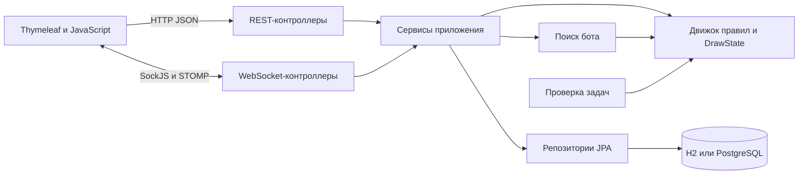

# Архитектура Checkers Online

Актуальная структура работающего приложения русских шашек 8×8.

## Слои приложения

Контроллер принимает команду и формирует ответ. Сервис проверяет права и состояние партии, задаёт транзакцию и обращается к движку. Движок вычисляет ходы без HTTP, Spring и базы данных. Репозиторий отвечает за чтение и запись сущностей. DTO отделяют сетевой контракт от структуры таблиц.

## Пакеты Java

| Пакет `com.checkers` | Ответственность |
| --- | --- |
| `config` | Spring Security, пул бота, планировщик, WebSocket, языки, источники настроек |
| `controller` | HTML-страницы, REST API авторизации, партий, задач и статистики |
| `service` | Сценарии игры, приглашения, подбор, бот, присутствие и статистика |
| `engine` | Позиция доски, допустимые ходы, ошибки, победа и объективные ничейные условия |
| `puzzle` | Проверка каталога задач и ограниченное доказательство выигрыша |
| `repository` | JPA-запросы к пользователям, партиям, ходам, приглашениям и refresh-токенам |
| `model.entity` | Сохраняемые сущности и их связи |
| `model.enums` | Режимы, статусы, цвета, сложности и типы событий |
| `dto`, `mapper` | Входные/выходные данные и преобразование сущностей в ответы |
| `security` | Представление пользователя, проверка JWT и контекст текущего запроса |
| `websocket` | STOMP-команды, события, публикация и проверка principal соединения |
| `assistant` | Локальный поиск готового ответа по базе FAQ |
| `seo` | Метаданные, sitemap, robots и правила индексации |
| `exception` | Машинные коды ошибок и единый формат HTTP-ошибки |

## Как проходит ход

1. `board.js` собирает полный путь, например `c3 → e5 → g7`, и вызывает обработчик `play.js`.
2. `play.js` отправляет STOMP-команду `/app/game/{id}/move` с JSON пути.
3. `GameWebSocketController` передаёт команду в `GameService.applyMove`.
4. Сервис загружает строку партии с `PESSIMISTIC_WRITE`, проверяет участника и очередь.
5. `CheckersRulesEngine.applyMove` проверяет весь путь и возвращает новую доску.
6. `DrawState` учитывает подтверждённый полуход. Позиция, журнал и результат сохраняются в транзакции.
7. После возврата сервиса контроллер публикует событие в `/topic/game/{id}`.
8. Оба клиента последовательно отображают событие; при игре с ботом планируется его ответ.

При ошибке отправитель получает сообщение в `/user/queue/errors`. Визуальная анимация браузера сама по себе не подтверждает ход.

## Что хранится

| Сущность | Основные данные |
| --- | --- |
| `User` | Имя, email, BCrypt-хеш, признак гостя, язык и победы/поражения/ничьи |
| `Game` | Режим, участники, статус, JSON позиции, JSON ничейной истории, предложение ничьей и результат |
| `Move` | Партия, последовательный номер полухода, весь путь, взятые поля и превращение |
| `GameInvite` | Код, создатель, партия, срок действия и статус приглашения |
| `RefreshToken` | Непрозрачный токен, пользователь, срок действия и отзыв |

У бота нет отдельного `User`; в партии с ботом человек играет белыми. Текущая позиция нужна для быстрой загрузки, журнал — для истории и восстановления ничейных счётчиков старых партий.

## Клиентские модули

| Файл в `static/js` | Назначение |
| --- | --- |
| `common.js` | Сессия, HTTP-клиент, звуки, меню, окна, фокус и присутствие на сайте |
| `i18n.js` | Поиск переводов и подстановка аргументов |
| `auth.js` | Регистрация, вход и гостевая сессия |
| `lobby.js` | Режимы, приглашения, очередь соперников и списки партий |
| `board.js` | Независимая доска: клетки, выбор, drag, анимации, отметки и премувы |
| `play.js` | Связь доски с серверной партией и обработка событий |
| `daily-task.js`, `tasks.js` | Карточка задачи, решение и восстановление прогресса |
| `history.js`, `rating.js` | История и персональные показатели |
| `assistant.js` | Интерфейс локального помощника |

Порядок CSS определён в `templates/fragments/head.html`: шрифты, базовая система, общая компоновка, уточнения оформления. На экране партии дополнительно применяется `game.css`. Метки `data-*` связывают разметку и обработчики без привязки к тексту перевода.

## Запуск и границы реализации

Локальный профиль `dev` использует H2 в памяти; `prod` подключается к PostgreSQL. Бот работает в отдельном пуле. Подбор соперников, STOMP simple broker, таймеры присутствия и метрики активных браузеров рассчитаны на один процесс приложения. Для нескольких экземпляров потребуется общая инфраструктура очередей, событий и присутствия.

Работающий помощник — локальный TF-IDF/поиск по ключевым словам. Внешняя языковая модель не подключена. Старая перегрузка `BotService.chooseMove(Long, ...)` также не используется и не реализована; рабочая версия принимает `Board`.
