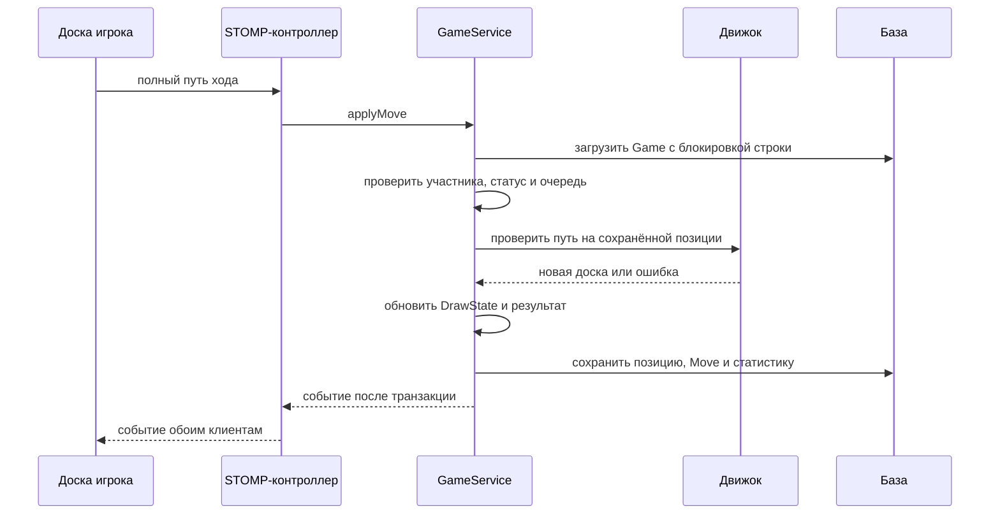

# Разбор проекта для защиты диплома

Это карта чтения текущего кода Checkers Online. Комментарии в исходниках объясняют отдельные методы, а здесь собраны связи между ними, алгоритмы и формулировки для защиты. Все пути ниже отсчитываются от корня репозитория.

## 1. Как представить проект

«Я разработал веб-приложение для русских шашек 8×8. Оно поддерживает игру с другом, подбор соперника и игру против бота трёх уровней. Сервер проверяет правила, сохраняет партии и рассылает события обоим игрокам. Отдельно реализованы задачи дня, история, статистика и интерфейс на русском, английском и армянском языках».

Затем показывай конкретный сценарий: начало партии → обязательное взятие → серия прыжков → результат в истории. Так каждое техническое решение можно связать с видимым действием.

## 2. В каком порядке читать код

| Порядок | Что открыть | Что понять |
| --- | --- | --- |
| 1 | `CheckersApplication`, `application.yml`, `pom.xml` | Точка входа, профили, зависимости и запуск Spring Boot |
| 2 | `engine/Square`, `Piece`, `Board`, `EngineMove` | Представление координат, фигуры, позиции и полного хода |
| 3 | `engine/CheckersRulesEngine` | Генерация допустимых ходов, применение и определение победителя |
| 4 | `engine/DrawState` | История повторений и отдельные ничейные счётчики |
| 5 | `model/entity`, `repository` | Таблицы, связи и запросы |
| 6 | `service/GameService` | Один законченный сценарий хода в транзакции |
| 7 | `websocket/controller/GameWebSocketController`, `static/js/play.js` | Передача команды и обработка события |
| 8 | `static/js/board.js` | Выбор пути, анимация и премувы |
| 9 | `service/BotService`, `BotPlayService` | Оценочный поиск и фоновое выполнение |
| 10 | `puzzle/PuzzleSolver`, `DailyPuzzleService` | Доказательство решения задачи против всех защит |
| 11 | `security`, `service/AuthService` | Проверка пользователя и жизненный цикл токенов |
| 12 | `src/test` | Примеры ожидаемого поведения и проверяемые граничные случаи |

Java-пути в таблице относятся к `src/main/java/com/checkers`, клиентские — к `src/main/resources`. Общая схема слоёв находится в [ARCHITECTURE.md](../ARCHITECTURE.md).

## 3. Термины и структуры

- **Простая шашка** ходит вперёд на одну диагональную клетку, но брать может в обе стороны.
- **Дамка** ходит на любое свободное расстояние по диагонали и может брать с расстояния.
- **Полуход** — действие одной стороны. Цепочка из нескольких прыжков всё равно является одним полуходом.
- **Полный ход** обычно включает полуход белых и полуход чёрных. Поэтому «15 ходов каждой стороны» нельзя проверять как 15 записей журнала.
- **Путь** содержит начало и все приземления: `c3, e5, g7`. Одних начальной и конечной клеток недостаточно для однозначного описания некоторых взятий дамкой.

`Square` использует индексы от 0 до 7. Белые продвигаются к индексу ряда 7, чёрные — к 0. Клетки `a1–h8` удобны для интерфейса и сетевых сообщений. Код `WM` означает белую простую, `WK` — белую дамку, `BM`/`BK` — чёрные фигуры.

`Board` — изменяемая позиция. `Piece`, `Square` и `EngineMove` — записи Java с данными. Копирование доски создаёт отдельное хранилище клеток; неизменяемые фигуры могут безопасно использоваться в нескольких позициях.

## 4. Проверка правил

`legalMoves` сначала получает все взятия. Если хотя бы одно найдено, тихие ходы не возвращаются. Это обеспечивает обязательность взятия на сервере. Правило выбора самой длинной серии здесь отсутствует: в русских шашках игрок выбирает любую полную допустимую серию.

`applyMove` проверяет координаты и сравнивает присланный путь с полными разрешёнными путями. При совпадении применяет его к копии позиции. Ошибка возвращается как `MoveError`, а исходная доска остаётся прежней. На результат не влияет то, какие подсказки нарисовал браузер.

### Как работает рекурсия взятия

1. Найти все возможные следующие прыжки из текущего поля.
2. Для каждого прыжка создать копию доски, пути и списка уже взятых клеток.
3. Переместить фигуру и проверить превращение.
4. Если появились продолжения, снова вызвать поиск для новой позиции той же фигуры.
5. Если продолжений нет, добавить весь накопленный путь в результат.

Это поиск в глубину по дереву возможных взятий. Копии изолируют соседние ветви. Рекурсия заканчивается: каждый прыжок добавляет новую взятую фигуру, число фигур конечно.

Взятые фигуры временно убираются с рабочей копии, но `capturedSet` сохраняет их клетки как препятствия до конца серии. Это не позволяет повторно перепрыгнуть уже взятую шашку. При достижении последнего ряда фигура сразу становится дамкой, и поиск продолжается по её правилам.

Победа устанавливается, когда у соперника нет фигур либо нет допустимых ходов. Отсутствие хода в шашках означает поражение. Объективные ничейные правила проверяются отдельно, с сохранением приоритета уже состоявшейся победы.

## 5. Почему ничьи отделены от Board

`Board` используется и в реальной партии, и в тысячах предположительных вариантов бота. Если бы каждый пробный ход увеличивал общие счётчики, бот создавал бы ложные повторения и ничьи. Поэтому `DrawState` изменяется только при сохранении настоящего хода в `GameService`.

Для повторения строится ключ: очередь хода + фигуры с цветом и типом в фиксированном порядке клеток. Даты и JSON-порядок ключей не участвуют. Начальная позиция считается первым появлением.

Счётчики раздельны:

| Счётчики | Что учитывают |
| --- | --- |
| `whiteQuiet`, `blackQuiet` | Дамочные ходы без движения простых и без взятий |
| `whiteStable`, `blackStable` | Ходы без изменения материального состава при наличии дамок у обеих сторон |
| `hunterMoves` | Только ходы стороны с тремя и более дамками против одной дамки |
| `roadMoves` | Только ходы атакующей стороны в специальном окончании на большой дороге |
| `plies` | Все подтверждённые полуходы партии |

Пределы выбираются по составу фигур. При взятии и превращении меняется материальный состав, поэтому соответствующий отсчёт начинается заново. Специальное правило большой дороги также проверяет расположение атакующих фигур и тактическое продолжение; его нельзя объяснять как безусловную ничью через любые пять ходов.

Приближённая оценка бота может вызвать **предложение** ничьей. Она не завершает игру принудительно. Игрок может отклонить предложение. В игре между людьми согласие требуется от обоих; роли судьи нет. Точные условия и ограничения описаны в [документе о ничьих](draws-and-premoves.md).

## 6. Один ход от браузера до базы



`@Transactional` объединяет связанные записи: нельзя сохранить ход и потерять относящееся к нему состояние партии при откате. `PESSIMISTIC_WRITE` сериализует изменения одной строки Game: одновременно пришедшие ход, сдача и согласие на ничью должны увидеть актуальный статус. Это не глобальная блокировка всего приложения.

`finishGame` проверяет уже завершённый статус, чтобы повторный вызов не начислил ещё один результат. Для бота отдельной записи User нет: в таких партиях `winner == null` нужно интерпретировать вместе с причиной окончания. Ничья проверяется раньше поражения человека.

## 7. Бот и minimax

Бот использует тот же движок ходов, что и человек. Для каждого кандидата он смотрит несколько полуходов вперёд. На своём ходе выбирает максимум оценки, на ходе соперника предполагает минимум — наиболее неудобный для себя ответ.

Глубины EASY/MEDIUM/HARD: 2/4/6 полуходов. На границе поиска вычисляется эвристика:

`материал + продвижение простых шашек + 3 × (мобильность бота − мобильность соперника)`.

Простая шашка стоит 100 условных единиц, дамка — 280; доказанный конечный результат оценивается значительно выше. Эти числа не являются вероятностью победы.

Альфа-бета-отсечения хранят уже найденные границы. Если исследуемая ветвь не может изменить выбор предка, оставшиеся варианты в ней не рассматриваются. В худшем случае перебор всё равно экспоненциальный, примерно `O(b^d)`, где `b` — число вариантов, `d` — глубина.

После поиска лёгкий уровень выбирает случайно среди верхних пяти кандидатов, средний — трёх, сложный — одного. Сила такого бота ограничена глубиной и эвристикой; он не гарантирует оптимальную игру до конца партии. `BotPlayService` запускает расчёт в отдельном пуле и повторно проверяет актуальность партии перед исполнением.

Старая перегрузка `chooseMove(Long, ...)` выбрасывает исключение и не участвует в игре. На защите показывай рабочую `chooseMove(Board, BotDifficulty)`.

## 8. Чем проверка задачи отличается от бота

`PuzzleSolver.distance` решает более узкую задачу: доказать выигрыш белых в заданном количестве полуходов. Белым достаточно одного доказанного продолжения, чёрным необходимо проверить все защиты. Если хотя бы одна защита не побеждена в пределах глубины, результат — `-1`, то есть «не доказано», а не «позиция точно ничейная».

Кеш учитывает и позицию, и остаток глубины. Белые выбирают кратчайшее доказательство, чёрные — наиболее долгую доказанную защиту. Сервер повторно проигрывает переданный план решения; браузер не может объявить победу самостоятельно. Задача выбирается по дате UTC, а принятые ходы сохраняются локально для восстановления интерфейса.

## 9. Премувы, анимация и звук

`state.board` в `board.js` хранит подтверждённую позицию. `projectedSquares` рисует отдельное будущее расположение после очереди премувов. Это позволяет выбрать ту же фигуру в её предполагаемом новом месте без изменения настоящей позиции.

При наступлении своего хода `play.js` запрашивает свежие разрешённые пути. `matchPremoveQueue` сопоставляет очередь с ними. Несколько запланированных прыжков могут объединиться в одну полную серию взятия. Поглощаются только реально исполненные записи; недопустимая очередь отменяется. Правый клик и Escape также очищают её.

Обновления позиции и STOMP-события проходят через очереди, чтобы быстрые ответы не перемешали анимации. Одинаковый повторный снимок не запускает движение снова. При неподтверждённом локальном ходе действует тайм-аут с запросом синхронизации.

Звук воспроизводится в `onLand`, когда фигура достигает очередной клетки. Поэтому три прыжка дают три отдельных контакта. Тихий дальний ход дамки различается со взятием по фигурам на пути, а не только по расстоянию. Записи деревянных контактов готовит `scripts/build-board-sounds.py`; источники и лицензия описаны рядом с готовыми WAV.

## 10. Авторизация и безопасность

`AuthService` сохраняет BCrypt-хеш пароля. При входе `PasswordEncoder.matches` сравнивает введённое значение с хешем. Исходный пароль не возвращается клиенту.

Access JWT подписан HMAC и содержит id, имя, признак гостя и срок действия. Подпись защищает от подмены, но содержимое JWT не зашифровано. Секрет задаётся серверным окружением. HTTP-фильтр проверяет токен и существование соответствующего пользователя; STOMP-перехватчик привязывает проверенный principal к соединению.

Refresh-токен — случайная строка, сохранённая в базе. При обновлении старый помечается отозванным и выдаётся новая пара. При выходе отзывается refresh; уже выданный access остаётся ограничен своим сроком действия. В текущей реализации refresh хранится в базе исходным значением, а браузерные токены — в localStorage. Не следует утверждать, что они зашифрованы или хранятся в HttpOnly-cookie.

Аутентификация отвечает на вопрос «кто отправил команду». Проверки в `GameService` отвечают на другой вопрос: «имеет ли этот пользователь право сделать это сейчас».

## 11. Что генерируют библиотеки

| Аннотация/механизм | Что делает |
| --- | --- |
| `@SpringBootApplication` | Включает запуск и автоматическую конфигурацию приложения |
| `@Service`, `@Controller`, `@Configuration` | Регистрируют компоненты для контейнера Spring |
| Внедрение через конструктор | Передаёт компоненту необходимые зависимости |
| `@Transactional` | Задаёт границу транзакции вызова сервиса через Spring |
| `@Entity`, `@ManyToOne`, `@Column` | Описывают отображение объектов в таблицы и связи |
| Spring Data JPA | Создаёт реализацию интерфейса репозитория и выполняет запросы |
| `@Valid`, ограничения Jakarta Validation | Проверяют входные DTO перед выполнением контроллера |
| Lombok `@Getter`, `@Setter`, `@Builder` | Генерирует методы доступа и построения объекта при компиляции |
| Thymeleaf `th:text`, `th:each`, `th:replace` | Подставляют серверные данные, повторяют элементы и подключают фрагменты |

У сгенерированного getter нет отдельного тела в исходнике. Его назначение описано у класса и данных. Это отличается от собственных методов, у которых добавлены индивидуальные комментарии.

## 12. Помощник, языки и оформление

Помощник выбирает готовый ответ из FAQ. Для русского и английского строятся TF-IDF-векторы и сравниваются по косинусной близости; вручную заданные ключевые слова добавляют бонус. Для армянского используется поиск по ключевым словам. Русская обработка окончаний упрощённая, полноценной лингвистической модели здесь нет. При слабом совпадении показывается запасной ответ со ссылкой на справку.

`LlmAssistantService` — заготовка, реального внешнего вызова модели в ней нет. Не называй локальный поиск генеративной нейросетью.

Переводы хранятся в `i18n/messages_*.properties`, а сервер передаёт словарь клиентским обработчикам. В базе язык хранится для зарегистрированного пользователя; у гостя используется cookie. События передают машинные коды и параметры, а перевод выбирает интерфейс получателя.

HTML описывает структуру, CSS — оформление, JavaScript — действия и состояния. Структура CSS сохранена: последовательность файлов образует существующий каскад. Классы и методы бэкенда снабжены комментариями на английском. Готовые файлы сторонних библиотек в `static/js/vendor` сохранены как поставляемые ресурсы с лицензиями.

## 13. Как показать проверку

```bash
# Компиляция, Java-тесты и сборка JAR
./mvnw package

# В отдельном терминале — приложение для браузерных сценариев
./mvnw spring-boot:run

# После установки зависимостей браузера согласно README
npm run test:browser
```

Модульные тесты проверяют отдельные правила и алгоритмы. Интеграционные поднимают Spring и проверяют взаимодействие с базой/API. Браузерные сценарии выполняют действия настоящего пользователя: нажатия, drag, очередь премувов, звук, языки и узкие экраны.

В 113 Java-файлах бэкенда и его тестов английскими комментариями описаны 126 типов и 439 методов/конструкторов. Дополнительно пояснены важные ветвления алгоритмов, поля состояния и серверные настройки. При проверке сравнивались синтаксические токены Java до и после правок без комментариев: исполняемый код сохранён.

## 14. Частые вопросы комиссии

**Почему сервер повторно проверяет ход, если клиент уже показывает доступные клетки?**
Браузер можно изменить или отправить команду напрямую. Только сервер владеет подтверждённой позицией и проверяет пользователя, очередь и полный путь.

**Зачем отделять движок от Spring?**
Правила можно тестировать без сервера и использовать одинаково в онлайн-игре, боте и задачах.

**Почему WebSocket, если есть HTTP?**
HTTP удобен для загрузки снимков и запросов. STOMP поверх WebSocket позволяет немедленно доставить ход или предложение ничьей обоим клиентам без постоянного опроса состояния партии.

**Почему не хранить только последнюю доску?**
Она не содержит числа прежних повторений и истории. Поэтому сохраняются журнал и отдельное ничейное состояние.

**Почему недостаточно одного счётчика ничьей?**
Разные правила сбрасываются по разным событиям и иногда считают ходы каждой стороны, иногда только атакующей. Один общий счётчик смешал бы эти условия.

**Можно ли запустить несколько экземпляров сервера?**
Текущие очередь подбора, простой брокер событий и присутствие живут внутри одного процесса. Для нескольких экземпляров потребуется общий брокер/хранилище и согласование таймеров. PostgreSQL сам по себе эту задачу не решает.

**Что происходит после перезапуска локального сервера?**
H2 в памяти теряет данные. PostgreSQL рабочего профиля сохраняет таблицы. Очереди и таймеры в памяти не являются сохраняемым состоянием базы.

**Какие ограничения честно назвать?**
Ограниченная глубина бота, упрощённая языковая обработка помощника, отсутствие внешнего LLM и судьи, инфраструктура для одного процесса. Предложение ничьей по эвристике и доказанная автоматическая ничья — разные механизмы.
